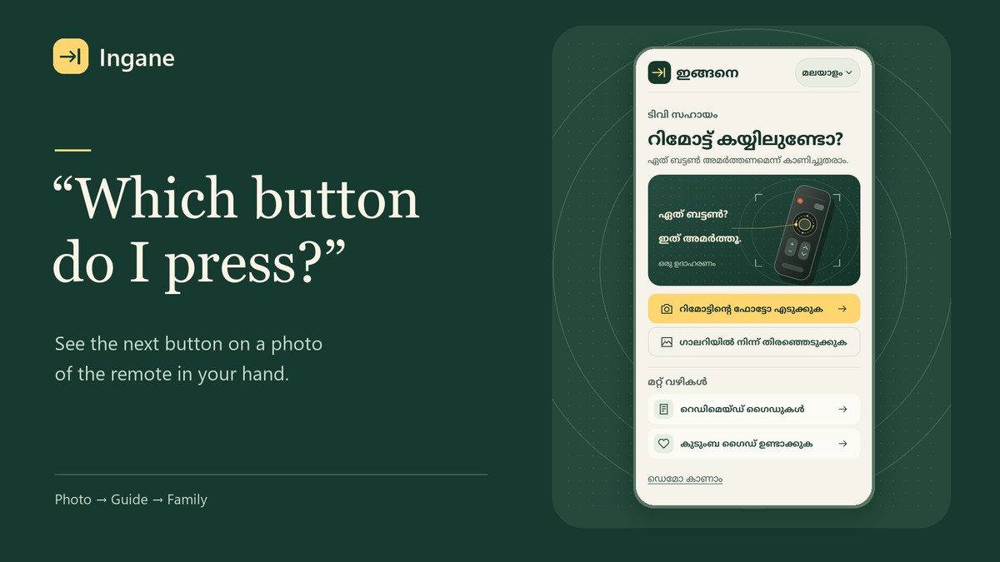
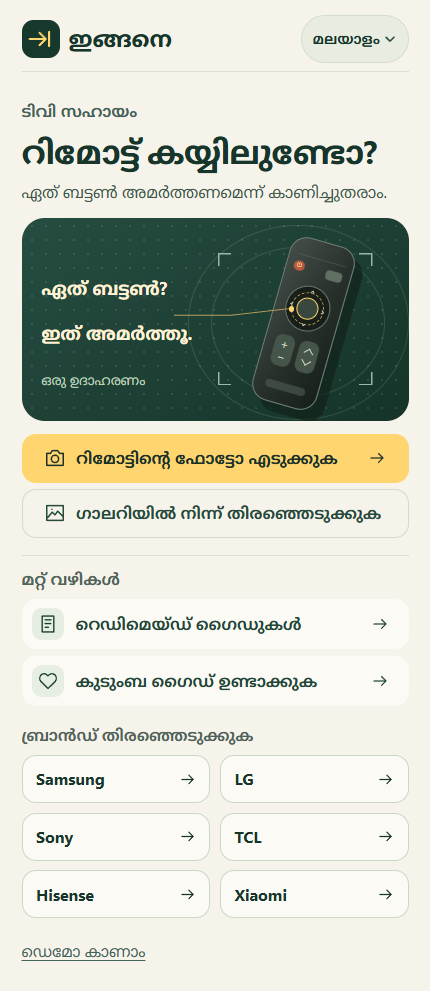
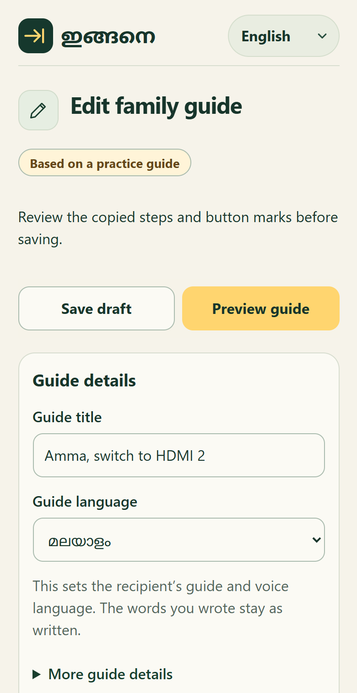
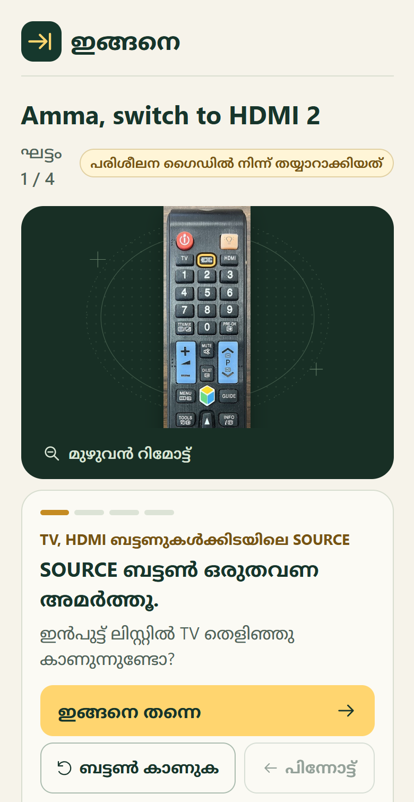
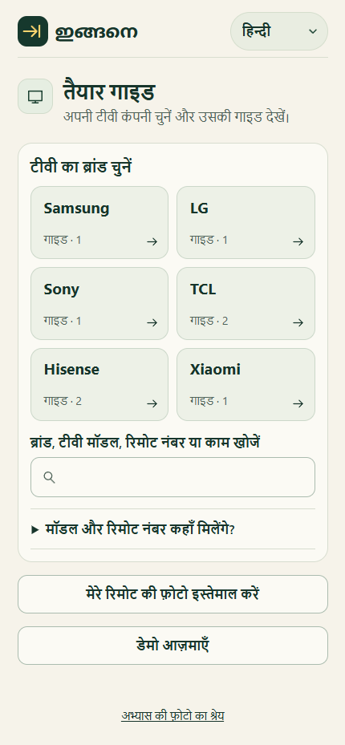
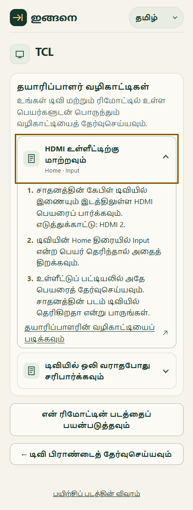

# Ingane · ഇങ്ങനെ

Ingane helps someone use the TV remote already in their hand. Take a photo, ask what to press, and follow the highlight one button at a time. A family member can turn those steps into a narrated guide and send a link that opens on another phone.

[Open Ingane](https://ingane.vercel.app/) · [Try HDMI 2 in Malayalam](https://ingane.vercel.app/?flow=presets&demo=hdmi-2&lang=ml) · [Open Family Guides in English](https://ingane.vercel.app/?flow=family&lang=en)

## Watch the walkthrough

[](https://ingane.vercel.app/demo/)

The video starts with a real photo request, then follows a family guide from the HDMI 2 practice menu to a signed-out recipient. At 0:36 you can hear the Malayalam instruction the recipient played. English captions are available. [Watch the video](https://ingane.vercel.app/demo/) · [Download the MP4](https://ingane.vercel.app/demo/ingane-demo.mp4)

| Start with your remote | Make a guide for Amma | Open it on her phone |
| :---: | :---: | :---: |
|  |  |  |

## Make “Amma, switch to HDMI 2”

1. Open **Create a family guide** and choose **Start from a ready-made guide**. Select **Try the demo → Ingane Demo → DEMO-TV-01**. Check the pictured button layout.
2. Select **Switch to HDMI**, the port **HDMI 2**, and **Malayalam**. Choose **Make a copy for family**. Name the copy *Amma, switch to HDMI 2* and review each press, expected result and recovery instruction. The original practice guide stays available.
3. **Preview guide** shows Amma’s player. **Save draft** keeps an editable copy on this device. For audio, record a step yourself or sign in with a creator passkey and choose **Add AI narration**.
4. Choose **Share link**, review who can open it, and create the read-only copy. **Share on WhatsApp** opens WhatsApp so you can choose the conversation and send it. **Copy link** also works.
5. Amma opens the link without signing in. She can listen, replay, go back, or choose **My screen looks different**. Each step waits for her confirmation.

To use your own remote, take a photo or choose one from the gallery. Review it, choose the guide language, describe the task and give consent to send the request. For HDMI, Ingane first highlights the Source/Input button on your photo. If the button is unclear, you can mark and confirm it yourself or choose another photo.

After you confirm the TV’s input list is open, type the exact labels you see or review and send a TV-screen photo. Choose the port your device is connected to when Ingane asks. The walkthrough finishes when you confirm the device’s picture appeared. You can copy a complete photo guide into Family Guides or start a family guide by marking buttons on a photo.

A blur or lighting warning is not an automatic rejection: continue if the relevant controls are visible, or retake the photo or confirm the actual button if Ingane is unsure. When Sarvam narration is available, new live photo guides read each step aloud by default. The browser may require a first tap to allow playback. The reader can mute or replay narration, and progress always waits for confirmation. Practice and shared Family Guides still play audio on tap.

For Wi-Fi, ask to turn Wi-Fi on or connect the TV. Ingane uses a recognized Settings/Home control and the visible TV menu labels to guide one screen at a time; it asks for a menu photo rather than guessing a path when evidence is missing. Enter passwords only on the TV and never photograph a password, code or QR screen. Some other requests get basic troubleshooting or a clarification instead of an exact button sequence.

## Languages and coverage

The home screen, brand guides, photo flow and family editor are available in **Malayalam, English, Hindi, Tamil, Kannada and Telugu**. Choose a language from the menu at the top. Photo and family guides can use a different language from the interface. The two photographed practice walkthroughs have authored steps and narration in Malayalam and English. Printed labels such as **SOURCE** and **HDMI 2** stay visible.

Choose a brand tile on the home screen or in **Ready-made guides** to read instructions for Samsung, LG, Sony, TCL, Hisense or Xiaomi. Each article names its applicable model or menu where relevant and links to the manufacturer. For example, the TCL tile opens instructions for switching to HDMI and checking missing sound. If the labels differ, choose **Use my remote photo**. [Open TCL guides](https://ingane.vercel.app/?flow=presets&brand=tcl&lang=en)

| Browse by TV brand in Hindi | Read a TCL guide in Tamil |
| :---: | :---: |
|  |  |

The separate practice collection has one photographed remote and two authored tasks, **Switch to HDMI** and **Restore muted sound**. Its example menu is opt-in. There are currently **zero device-verified TV presets**. Publishing a real preset requires a rights-cleared, front-on photo, a match to the exact TV model and remote part number, and a physical check of each button, starting screen and menu outcome on the stated firmware. The user presses every button on their own TV.

## Run locally

Use Node.js 26 and npm. From a clean clone, install the locked dependencies and make a development build.

```sh
npm ci
npm run build
```

For a first run, copy `.env.example` to `.env` (`Copy-Item .env.example .env` in PowerShell). Set `INGANE_PROVIDER=mock` to try photo guidance with labeled demo responses and local draft editing. The authored HDMI example also works on a static build without keys.

```sh
npm run dev:server
```

In a second terminal, start the web app. [Open the local app](http://127.0.0.1:5173/?lang=en)

```sh
npm run dev
```

For live service, set `INGANE_PROVIDER=live` and configure only the features you need. Keep secrets in the server environment.

| Setting | What it enables |
| --- | --- |
| `OPENAI_API_KEY` | Photo guides through the OpenAI Responses API. The project needs credit and access to the selected models. |
| `OPENAI_MODEL` | Writes the guide steps. Defaults to `gpt-6.2-astra`. Existing environment settings still override it. |
| `OPENAI_VISION_MODEL` | Locates remote buttons and reads TV screen labels. Defaults to the planner model (except legacy Luna configurations, which keep their GPT-5.5 vision fallback). |
| `SARVAM_API_KEY` | Spoken requests and read-aloud through the official Sarvam AI SDK. Defaults are `saaras:v4` for transcription and `bulbul:v3` for narration. Text works independently. |
| `NARRATION_SECRET` | A stable random server secret for narration, photo-guide continuations and hosted authentication. Use the same value across server instances. |
| `INGANE_FAMILY_DATABASE_URL` | Hosted private PostgreSQL storage for passkeys, shared snapshots, photos and audio. |

`npm run check:openai` sends a small checkerboard to the configured vision model. It uses provider credit. The active configuration and language-specific voice settings are listed in [.env.example](.env.example).

## Family sharing and privacy

Drafts live in the creator’s browser. Sharing writes a separate snapshot to private storage. Anyone who receives or is forwarded the link can view it for **seven days**, or until the creator chooses **Stop sharing**. Editing a draft leaves the sent copy intact. **Replace shared copy and revoke old link** creates a new link. Revocation blocks future requests for the guide, photo and recordings. Copies a recipient has already saved remain with them.

The hosted app uses passkeys for creator sign-in and PostgreSQL for private media. Only a hash of the random link token is stored. The token travels in the URL fragment and is sent to the private API in a request header. Shared pages use a generic link preview. Narration plays on tap and the instruction remains visible when audio is unavailable.

For a separate installation, apply the [PostgreSQL schema](server/family/schema.sql) to a private database and supply a TLS-enabled runtime connection string. Configure the passkey origin for the host you operate in the [hosted entry point](hosting/api.ts). The production origin for this project is `https://ingane.vercel.app`. For an isolated local test of the complete sharing path, run the disposable-database check below.

<details>
<summary>Try sharing manually on localhost with SQLite and a temporary creator key</summary>

Run this in PowerShell after building. It puts a freshly generated creator key on your clipboard and gives the local server its hash. Shared copies are stored in the ignored `.ingane-private` directory.

```powershell
$creator = node --input-type=module -e "import {randomBytes,createHash} from 'node:crypto'; const key=randomBytes(32).toString('base64url'); process.stdout.write(JSON.stringify({key,hash:createHash('sha256').update(key).digest('hex')}))" | ConvertFrom-Json
$env:INGANE_FAMILY_CREATORS = @{ local = $creator.hash } | ConvertTo-Json -Compress
$env:INGANE_FAMILY_PRIVATE_DIR = Join-Path $PWD '.ingane-private'
$env:HOST = '127.0.0.1'
$env:PORT = '18874'
Set-Clipboard -Value $creator.key
npm start
```

Open [local Family Guides](http://127.0.0.1:18874/?flow=family&lang=en), paste the key into **Creator access key** and sign in. Create a link, open it in a private window on this computer, then try **Stop sharing**. Use the hosted app for links that open on a second phone.

</details>

## Verify a checkout

```sh
npm test
npm run typecheck
npm run build
npm run build:hosted
```

The hosted build prints a fresh directory containing the app, the server function, the licensed practice photo and the walkthrough video. The following checks use your installed Chrome. Replace `<public-build-directory>` with the directory printed above.

```sh
node scripts/check-hosted.mjs "<public-build-directory>"
node --import tsx scripts/check-family-sharing.mjs "<public-build-directory>"
```

The second command registers disposable creator passkeys, makes an HDMI 2 guide in Malayalam, opens its link in a separate signed-out browser, checks ownership and draft isolation, replaces the snapshot and revokes access to its media. It uses a disposable local database and requires no live keys.

The mobile photo suite draws its own test images. To run the browser suites, start the built server on port 8787 with `INGANE_PROVIDER=mock` and `INGANE_MOCK_FAILURES=1` in its environment.

```sh
node scripts/e2e-check.mjs http://127.0.0.1:8787/
node scripts/e2e-v2.mjs http://127.0.0.1:8787/
npm run e2e:v3 -- http://127.0.0.1:8787/
npm run e2e:library -- http://127.0.0.1:8787/
npm run e2e:press -- http://127.0.0.1:8787/
npm run e2e:v4
```

The optional `npm run check:guide-languages` exercises synthetic spoken requests, guide generation and read-aloud in the four additional languages using live provider credit.

## Source and credits

The shared player and photo overlay are in [src/player](src/player). The [preset registry](src/data/presets) separates photographed button layouts from TV menu routes. The [family editor](src/family), [server-side sharing](server/family) and [AI and speech adapters](server/providers) use the contracts in [shared](shared).

The public practice crop comes from *CooLux Remote for Samsung LED TV* by **TaurusEmerald**, licensed under **CC BY-SA 4.0**. Ingane cropped, resized and removed metadata from the photograph. The same image appears with overlays in the screenshots and video. The crop and its adaptations are available under the same license. [Original photograph](https://commons.wikimedia.org/wiki/File:CooLux_Remote_for_Samsung_LED_TV.jpg) · [Photo credit and changes](hosting/media/photo-credit.txt) · [CC BY-SA 4.0](https://creativecommons.org/licenses/by-sa/4.0/)

Ingane bundles Noto Sans Malayalam under the SIL Open Font License. [Font license](public/fonts/OFL.txt)
